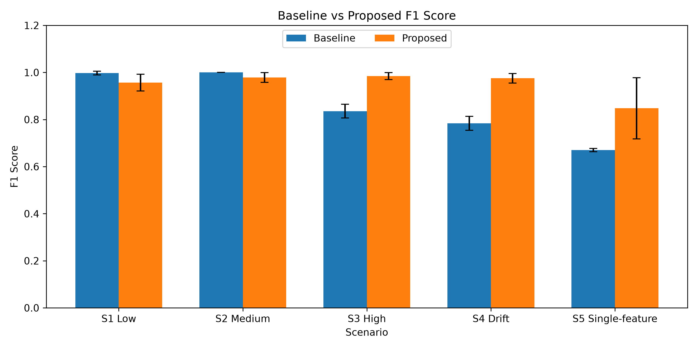
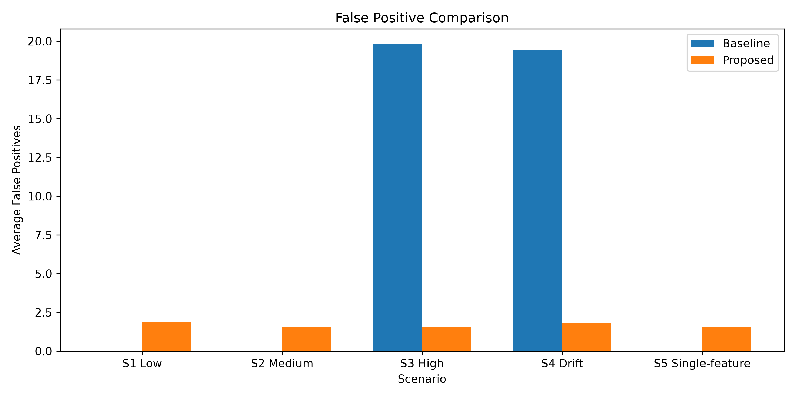
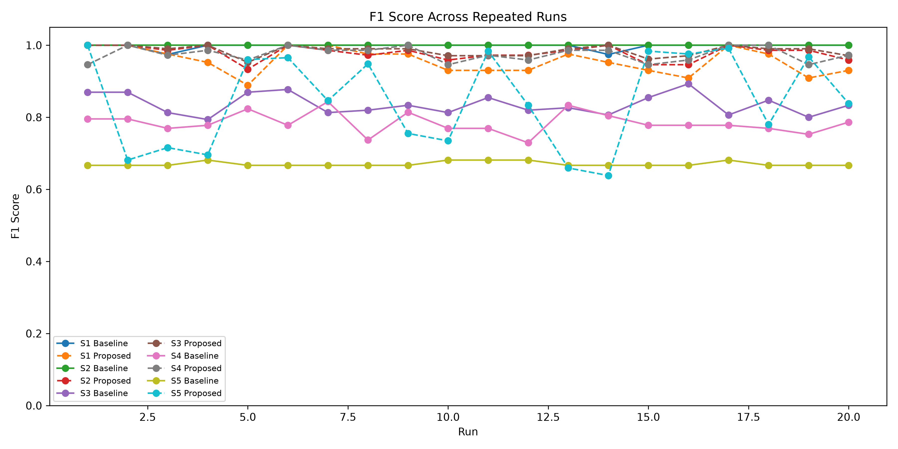

# Real-Time Network Attack / Anomaly Detector

A network anomaly detection system that compares a traditional fixed-threshold detector with a proposed adaptive anomaly detector.

## Overview

The project detects suspicious network behaviour using traffic-level metadata and compares:

- **Baseline:** Fixed-threshold detection.
- **Proposed:** Adaptive EWMA-style learning with weighted z-score anomaly detection.

The system includes a Streamlit dashboard for traffic simulation, repeated-run evaluation, visualization, and performance comparison.

## Key Features

- Real-time traffic simulation
- Baseline vs. proposed detector comparison
- Adaptive anomaly detection
- EWMA-based traffic profiling
- Weighted anomaly scoring
- Runtime threshold controls
- F1-score, precision, and recall evaluation
- False-positive comparison
- Repeated-run statistical evaluation
- Interactive Streamlit dashboard
- Optional real packet metadata capture

## Detection Method

### Baseline Detector

The baseline uses fixed thresholds for:
- Packet rate
- Destination diversity
- Failed connection behaviour

An alert is generated when a traffic feature exceeds its configured threshold.

### Proposed Adaptive Detector

The proposed method:

1. Learns the normal traffic profile during a warm-up period.
2. Updates the profile using EWMA-style adaptation.
3. Calculates normalized z-score deviations.
4. Combines multiple anomaly signals using weighted scoring.
5. Generates an alert when the anomaly score exceeds the configured threshold.

This approach is designed to adapt to changing traffic conditions and reduce unnecessary alerts.

## Experimental Scenarios

| Scenario | Description |
|---|---|
| S1 | Low-load traffic |
| S2 | Medium-load traffic |
| S3 | High-load / highly variable traffic |

The evaluation uses synthetic traffic for safe, reproducible experiments without generating real attacks.

## Results

The system was evaluated using 20 repeated runs.

| Scenario | Baseline F1 | Proposed F1 | Baseline Avg. FP | Proposed Avg. FP |
|---|---:|---:|---:|---:|
| S1 | 0.997 | 0.999 | 0.00 | 0.05 |
| S2 | 1.000 | 1.000 | 0.00 | 0.00 |
| S3 | 0.821 | 1.000 | 21.95 | 0.00 |

### Result Visualizations

#### F1 Score Comparison



#### False Positive Comparison



#### Repeated-Run F1 Scores



### Main Result

The largest improvement occurs in **S3**, where the proposed adaptive detector:

- Improves F1-score from **0.821 to 1.000**.
- Reduces average false positives from **21.95 to 0.00**.

These results indicate improved performance under the tested high-variation synthetic traffic conditions.

## Dashboard

The Streamlit dashboard provides:

- Scenario selection
- Adaptive z-threshold control
- Anomaly-score threshold control
- Repeated-run configuration
- Live anomaly-score visualization
- Baseline and proposed detector decisions
- Simulation summaries

## Project Structure

```text
network-anomaly-detector/
├── app.py
├── live_capture.py
├── make_graphs.py
├── run_evaluation.py
├── requirements.txt
├── README.md
├── src/
│   ├── __init__.py
│   ├── config.py
│   ├── detectors.py
│   ├── evaluate.py
│   └── traffic.py
├── results/
│   ├── f1_comparison.png
│   ├── false_positive_comparison.png
│   ├── repeated_runs_f1.png
│   ├── repeated_runs.csv
│   └── summary_results.csv
└── reports/
    ├── figures/
    └── project_structure.txt
```

## Installation

Create and activate a virtual environment.

**Windows PowerShell:**

```powershell
python -m venv .venv
.\.venv\Scripts\Activate.ps1
```

Install dependencies:

```powershell
pip install -r requirements.txt
```

## Run the Dashboard

```powershell
streamlit run app.py
```

## Run the Evaluation

```powershell
python run_evaluation.py
```

Generate graphs:

```powershell
python make_graphs.py
```

## Optional Live Packet Capture

The optional `live_capture.py` script uses Scapy to collect network packet metadata. Live capture may require Npcap and appropriate permissions on Windows.

Only monitor networks you own or are explicitly authorized to inspect.

## Limitations

- Evaluation uses synthetic rather than production network traffic.
- Real packet capture depends on operating-system and interface support.
- The detector uses traffic metadata and does not inspect encrypted payload contents.
- Performance on real networks requires further testing and threshold tuning.

## Technologies

- Python
- Streamlit
- Pandas
- Matplotlib
- Scapy (optional live capture)

## Project Outcome

The project implements and compares a fixed-threshold baseline and an adaptive statistical anomaly detector through an interactive dashboard and repeated-run evaluation.
